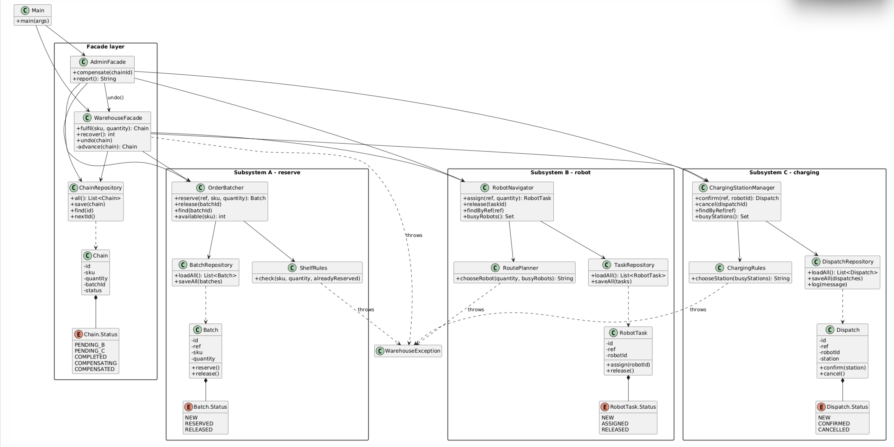

# Warehouse Robotics - Facade (variant 18)

One order goes through three independent subsystems: **A** reserve goods -> **B** assign a robot -> **C** charging + dispatch. If B or C fails, the facade undoes the earlier steps in reverse order. Everything is saved in CSV files in `data/`.

Subsystem

Classes

A (Order Batcher / Shelf)

`OrderBatcher`, `Batch`, `ShelfRules`, `BatchRepository`

B (Robot Navigator)

`RobotNavigator`, `RobotTask`, `RoutePlanner`, `TaskRepository`

C (Charging / Dispatch log)

`ChargingStationManager`, `Dispatch`, `ChargingRules`, `DispatchRepository`

Facades

`WarehouseFacade` (order, recover, undo), `AdminFacade` (report, manual compensation)

Other

`Chain` + `ChainRepository` (saved progress), `WarehouseException`, `Main`

UML: `img/uml.png`. 

## Demo

Rules: every SKU has 100 units on the shelf, a robot carries at most 40, there are 3 robots and 2 charging stations.

1.  Order `BOX` x10 -> COMPLETED. Option 2 shows A RESERVED, B ASSIGNED, C CONFIRMED.
2.  **B fails after A:** order `BOX` x60 (too heavy for a robot) -> FAILED, A is RELEASED.
3.  **C fails after A and B:** make two successful orders (both charging stations are taken), a third order fails at C -> B and A are RELEASED.
4.  **Failure at the first step:** order x500 or SKU `bad sku!` -> rejected, nothing is saved.
5.  Exit and start again: all data is still there. Option 3 compensates a finished order by hand.

## How progress is saved

`Chain.status` is saved after each step: `PENDING_B` -> `PENDING_C` -> `COMPLETED` (or `COMPENSATING` -> `COMPENSATED`). On start, `recover()` reads the chains from disk and continues the interrupted ones. When undoing, the facade looks at what each subsystem has really saved (Dispatch CONFIRMED, RobotTask ASSIGNED, Batch RESERVED) and undoes only that, in the order C, B, A.

## Least Knowledge: before / after

Before: the client must know A, B and C, the order, how data goes from B to C, and write the undo itself.

```java
Batch batch = batcher.reserve(id, sku, qty);
try {
    RobotTask task = navigator.assign(id, qty);
    try {
        charging.confirm(id, task.getRobotId());
    } catch (WarehouseException e) {
        navigator.release(task.getId());
        batcher.release(batch.getId());
        throw e;
    }
} catch (WarehouseException e) {
    batcher.release(batch.getId());
    throw e;
}
```

After: one call, one friend.

```java
Chain chain = facade.fulfil(sku, qty);   // on failure: WarehouseException, already rolled back
```

## Why Facade and not Adapter

An Adapter makes one existing class fit an interface that the client already expects. Here the client expects nothing: there are three different subsystems, and the client only wants one simple operation, "fulfil an order". The facade hides which subsystems exist, in which order they run, what data is passed between them and how to undo them. That is the intent of Facade: a simpler interface over a group of classes.

## Tests

28 JUnit 5 tests. `Scenario` is the small test language (`warehouse.order("BOX", 10).orderFails("BOX", 60).thenChain("CH-2", COMPENSATED)`). They cover each subsystem alone, both undo cases, the undo order, three restart cases and the admin facade. Line coverage is about 99% (JaCoCo, without `Main`).